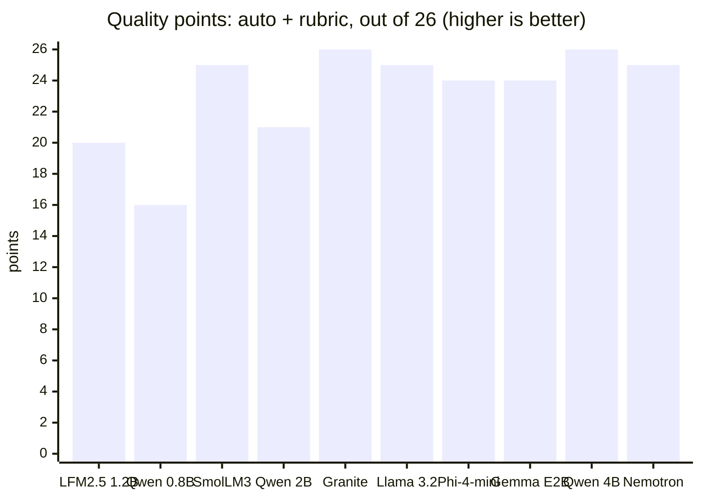
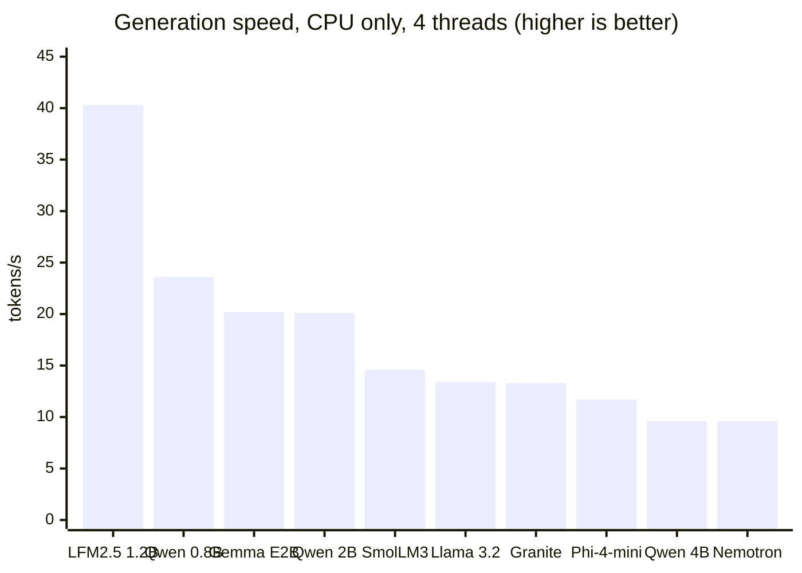
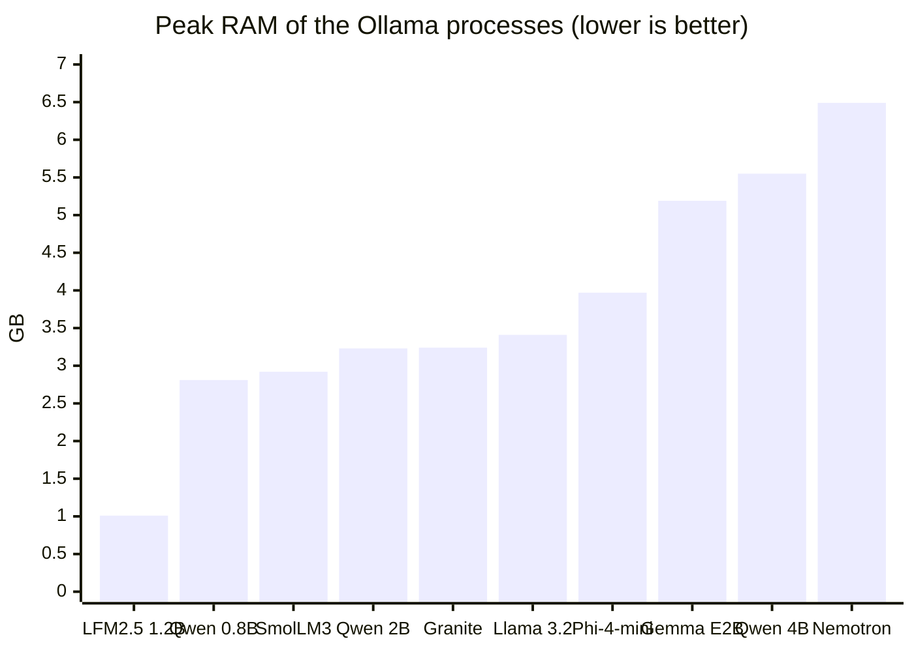

<div align="center">

# 🧪 Small LLM Bench

**Which 1B to 4B open model should you actually run on a normal laptop?**

Ten small English-capable language models, measured on real hardware with [Ollama](https://ollama.com):
speed, peak RAM, load time, and answer quality, CPU-only and on a GPU.


</div>

---

## ⚡ TL;DR

| If you want... | Pick | Why |
|---|---|---|
| 🏆 **Best all-rounder** | **Granite 4.2 3B** (IBM) | Only model with a perfect score on both test sets (14/14 auto, 12/12 rubric) while staying near 3 GB of RAM |
| 🪶 **Smallest and fastest** | **LFM2.5-1.2B** (Liquid AI) | About 1 GB of RAM and 40 tokens/s on 4 CPU threads, but weaker at math |
| 🎯 **Best under 3 GB** | **SmolLM3-3B** (Hugging Face) | 13/14 auto and 12/12 rubric at 2.9 GB peak RAM |
| 🧠 **Most capable, if you have 16 GB** | **Qwen3.5-4B** or **Nemotron 3 Nano 4B** | Perfect auto scores and clean thinking mode, but 5.5 to 6.5 GB of RAM and under 10 tokens/s on CPU |
| 🎮 **Have any NVIDIA GPU?** | Any of them | Every model ran at 86 to 339 tokens/s on an 8 GB laptop GPU |

---

## 📊 Results at a glance

Measured on CPU with 4 threads (Profile A, the "ordinary laptop" setting), sorted by peak RAM.

| Model | Developer | Download | Peak RAM | Fits 8 GB laptop? | CPU tok/s (4 thr) | CPU tok/s (all) | GPU tok/s | Load | Auto score | Rubric | Est. tok/s on Intel N150 |
|---|---|---:|---:|:---:|---:|---:|---:|---:|:---:|:---:|---:|
| LFM2.5-1.2B-Instruct | Liquid AI | 0.73 GB | 1.01 GB | ✅ yes | **40.3** | 41.7 | **338.8** | 0.8 s | 11/14 | 9/12 | 27.2 |
| Qwen3.5-0.8B (Q8_0) | Alibaba Qwen | 1.32 GB | 2.81 GB | ✅ yes | 23.6 | 24.9 | 175.3 | 3.6 s | 8/14 | 8/12 | 15.9 |
| SmolLM3-3B | Hugging Face | 1.92 GB | 2.92 GB | ✅ yes | 14.6 | 15.8 | 136.7 | 3.1 s | 13/14 | **12/12** | 9.9 |
| Qwen3.5-2B | Alibaba Qwen | 1.95 GB | 3.23 GB | 🟡 tight | 20.1 | 20.3 | 156.5 | 2.3 s | 11/14 | 10/12 | 13.6 |
| **Granite 4.2 3B** | IBM | 2.24 GB | 3.24 GB | 🟡 tight | 13.3 | 13.7 | 116.3 | 2.3 s | **14/14** | **12/12** | 9.0 |
| Llama 3.2 3B Instruct | Meta | 2.02 GB | 3.41 GB | 🟡 tight | 13.4 | 14.3 | 130.2 | 2.6 s | **14/14** | 11/12 | 9.1 |
| Phi-4-mini-instruct | Microsoft | 2.49 GB | 3.97 GB | 🟡 tight | 11.7 | 11.9 | 111.1 | 2.6 s | 13/14 | 11/12 | 7.9 |
| Gemma 4 E2B (QAT) | Google | 4.34 GB | 5.19 GB | ❌ no | 20.2 | 19.7 | 149.9 | 5.1 s | 12/14 | **12/12** | 13.6 |
| Qwen3.5-4B | Alibaba Qwen | 3.32 GB | 5.55 GB | ❌ no | 9.6 | 9.2 | 86.2 | 4.8 s | **14/14** | **12/12** | 6.5 |
| Nemotron 3 Nano 4B | NVIDIA | 2.84 GB | 6.49 GB | ❌ no | 9.6 | 9.9 | 102.5 | 2.3 s | **14/14** | 11/12 | 6.5 |

<details>
<summary><b>How to read this table</b></summary>

- **Peak RAM**: highest combined memory (working set) of all Ollama processes, sampled every 0.5 s, during the CPU 4-thread run.
- **Fits 8 GB laptop?** ✅ yes = at most 3.0 GB, leaving room for Windows and a browser. 🟡 tight = 3.0 to 4.5 GB, works if you close other apps. ❌ no = above 4.5 GB.
- **tok/s**: generation speed, `eval_count / eval_duration` from Ollama, median of 9 runs (3 prompts x 3 repeats, 256 tokens each).
- **Load**: cold model load time from Ollama's `load_duration` (model files were likely in the OS file cache).
- **Auto score**: 14 machine-checked tasks (4 math/logic, 4 coding with unit tests, 4 strict instruction-following, 2 multi-turn).
- **Rubric**: 6 open-ended answers (4 explanations, 2 summaries), 0 to 2 points each, scored by an AI judge against [rubric.md](rubric.md). A rough signal, not a formal evaluation.
- **Est. tok/s on Intel N150**: an *estimate*, not a measurement. See [Calibration](#-calibration-what-would-this-feel-like-on-a-cheap-laptop).
</details>

### Quality vs memory

Models are ordered from least to most peak RAM (shown in the header row of the table below the chart). The best picks score high while sitting toward the left.



| | 1.0 GB | 2.8 GB | 2.9 GB | 3.2 GB | 3.2 GB | 3.4 GB | 4.0 GB | 5.2 GB | 5.5 GB | 6.5 GB |
|---|---|---|---|---|---|---|---|---|---|---|
| **Model** | LFM2.5 1.2B | Qwen 0.8B | SmolLM3 | Qwen 2B | **Granite** | Llama 3.2 | Phi-4-mini | Gemma E2B | Qwen 4B | Nemotron |
| **Quality /26** | 20 | 16 | 25 | 21 | **26** | 25 | 24 | 24 | 26 | 25 |

### CPU speed (4 threads, tokens per second)



### Peak RAM (GB, CPU 4 threads)



---

## 🧭 Which one should I use?

```
Your laptop RAM
│
├── 4 GB ─────────► LFM2.5-1.2B         (only model near 1 GB; fine for chat, weak at math)
│
├── 8 GB ─────────► Granite 4.2 3B      (best quality that still fits)
│                   SmolLM3-3B          (if you need to stay under 3 GB)
│
├── 16 GB ────────► Qwen3.5-4B          (strongest overall, slower)
│                   Nemotron 3 Nano 4B  (very short, accurate thinking mode)
│
└── NVIDIA GPU ───► anything here; even the 4B models exceed 85 tok/s
```

---

## 🧠 Thinking mode (reasoning on vs off)

Same 8 math and logic prompts, CPU with all cores, thinking budget up to 3,072 tokens.

| Model | Thinking off | Thinking on | Avg tokens per answer (on) | Notes |
|---|:---:|:---:|---:|---|
| Nemotron 3 Nano 4B | 8/8 | 8/8 | 234 | Shortest reasoning by far |
| Gemma 4 E2B | 5/8 | **8/8** | 673 | Biggest gain from thinking |
| Granite 4.2 3B | 7/8 | **8/8** | 776 | |
| Qwen3.5-4B | 8/8 | 8/8 | 1,069 | |
| Qwen3.5-2B | 8/8 | 6/8 | 1,595 | 2 answers hit the token cap |
| Qwen3.5-0.8B | 5/8 | 1/8 | 2,994 | 7 of 8 hit the token cap; overthinks |
| SmolLM3-3B | 8/8 | n/a | | No thinking produced through Ollama (tried the `think` flag and `/think`) |
| LFM2.5-1.2B | 6/8 | n/a | | Instruct model, no thinking produced |
| Llama 3.2 3B | 7/8 | n/a | | No thinking mode |
| Phi-4-mini | 8/8 | n/a | | No thinking mode |

**Takeaway:** thinking helps the mid-size models, but it costs 2 to 11 times more output tokens than thinking off. On a 10 tok/s CPU that often means more than a minute per answer. The 0.8B model gets *worse* with thinking on.

---

## 📝 Model notes

<details>
<summary><b>Granite 4.2 3B</b> (IBM, Apache 2.0) 🏆</summary>

Perfect on every machine-checked task and every rubric item, at 3.24 GB peak RAM and 13.3 tok/s on 4 threads. Thinking mode lifted math/logic from 7/8 to 8/8 with moderate token use. The only miss was one of two summary word limits.
</details>

<details>
<summary><b>LFM2.5-1.2B-Instruct</b> (Liquid AI, LFM Open License)</summary>

By far the lightest and fastest: 1.01 GB peak RAM, 40 tok/s on 4 threads, 339 tok/s on GPU, 0.8 s load. Coding and instruction-following were solid (4/4 and 3/4), but math/logic was 2/4 and the open-ended answers scored 9/12, behind every 2B+ model. Good for chat, rewriting and simple tasks on very weak machines.
</details>

<details>
<summary><b>SmolLM3-3B</b> (Hugging Face, Apache 2.0)</summary>

The best quality under 3 GB: 13/14 auto, 12/12 rubric at 2.92 GB. Its thinking mode could not be triggered through Ollama with this GGUF, so it is reported without one.
</details>

<details>
<summary><b>Llama 3.2 3B Instruct</b> (Meta, Llama 3.2 Community License)</summary>

Reliable and well known: 14/14 auto, 11/12 rubric, 3.41 GB, 13.4 tok/s. No thinking mode. It is also the calibration anchor for the older-laptop estimates.
</details>

<details>
<summary><b>Qwen3.5-2B</b> (Alibaba Qwen, Apache 2.0)</summary>

Fast for its size (20 tok/s) but uneven: 2/4 on coding and 0/2 on summary length limits. Thinking mode made it slightly worse (8/8 off, 6/8 on) because answers ran into the token cap.
</details>

<details>
<summary><b>Phi-4-mini-instruct</b> (Microsoft, MIT)</summary>

Strong at math and code (8/8 math/logic with thinking off, 4/4 code) but the heaviest model that still counts as "tight" (3.97 GB) and the slowest of that group at 11.7 tok/s. Missed both summary length limits.
</details>

<details>
<summary><b>Gemma 4 E2B</b> (Google, Apache 2.0)</summary>

Good writing (12/12 rubric) and fast for its size (20 tok/s), but it needs 5.19 GB of RAM in this setup, likely because the model also carries vision and audio parts. Weak at math with thinking off (2/4 in the main test, 5/8 on the reasoning set), perfect with thinking on (8/8).
</details>

<details>
<summary><b>Qwen3.5-4B</b> (Alibaba Qwen, Apache 2.0)</summary>

Top quality (14/14, 12/12) and a clean thinking mode, but 5.55 GB of RAM and 9.6 tok/s on 4 threads. A good choice on 16 GB machines or any GPU.
</details>

<details>
<summary><b>Nemotron 3 Nano 4B</b> (NVIDIA, NVIDIA Nemotron Open Model License)</summary>

14/14 auto with the most token-efficient thinking (234 tokens on average). However it used the most RAM (6.49 GB) and was slowest on long prompts (52.8 s to first token for a roughly 2,000-token prompt on 4 threads). Its model card lists English as the supported language.
</details>

<details>
<summary><b>Qwen3.5-0.8B</b> (Alibaba Qwen, Apache 2.0)</summary>

The smallest by parameters, but Ollama's default tag is Q8_0, so it used more RAM (2.81 GB) than several 3B models at Q4. It failed all 4 coding tasks and degraded badly with thinking on. Not recommended over LFM2.5-1.2B.
</details>

---

## 🔬 Methodology

### Hardware and software

| | |
|---|---|
| CPU | Intel Core i7-13650HX (14 cores, 20 threads) |
| RAM | 16 GB |
| GPU | NVIDIA GeForce RTX 5060 Laptop, 8 GB |
| OS | Windows 11 |
| Runtime | Ollama 0.40.2 (llama.cpp based), default quantizations (mostly Q4_K_M) |
| Settings | temperature 0, seed 42, context 4,096 tokens, one model loaded at a time |

### Three profiles

| Profile | What it simulates | Setup |
|---|---|---|
| **A** | An ordinary laptop | CPU only, 4 threads, Ollama process pinned to 4 physical P-cores (CPUs 0, 2, 4, 6) |
| **B** | A strong laptop | CPU only, all cores (14 threads), plus the thinking-mode test |
| **C** | A laptop with a GPU | Full GPU offload, speed and long-prompt tests only |

### What was measured for every model and profile

1. **Cold load** time.
2. **Speed**: 3 prompts x 3 repeats, 256 output tokens each. Repeat 1 vs repeat 3 doubles as a thermal throttling check.
3. **Long prompt**: a roughly 1,600 to 2,000 token table of orders, then a counting question. Gives prompt-processing speed and time to first token.
4. **Quality** (Profiles A and B): 20 prompts in [prompts.json](prompts.json), generated by [scripts/make_prompts.py](scripts/make_prompts.py):
   - 4 general explanations and 2 summaries (rubric scored),
   - 3 math and 1 logic question (exact answer checked),
   - 4 Python functions (run against unit tests in a subprocess),
   - 4 strict format instructions (exact bullet count, valid JSON, word limit, required word and ending),
   - 2 multi-turn tests (follow a system style rule, remember earlier turns).
5. **Reasoning** (Profile B): the 4 math/logic prompts plus 4 extra ones, thinking off and on.
6. **Memory**: a background sampler records RAM of all Ollama processes, free system RAM and GPU memory every 0.5 s.

The pipeline is strictly sequential: pull one model, run A, B and C, delete it, move to the next. Nothing downloads during a timed run, and only one model is ever loaded.

---

## 📐 Calibration: what would this feel like on a cheap laptop?

Speeds above come from a fast CPU. To estimate a budget machine, the Llama 3.2 3B result is scaled against a published figure:

> Intel N150 mini PC, CPU only, `llama3.2:3b` in Ollama: **9.06 tok/s** ([geerlingguy/ai-benchmarks](https://github.com/geerlingguy/ai-benchmarks))
>
> This machine, Profile A: **13.43 tok/s** → factor **0.675**

Every model's Profile A speed is multiplied by 0.675 to get the "Est. tok/s on Intel N150" column. This assumes all models scale the same way, which is an approximation. A secondary figure of about 10.0 tok/s on an Intel i5-10210U (MetriLLM) could not be verified and is not used.

---

## 📚 Published specs vs what we measured

| Model | Licence | Params | Context | Published headline numbers |
|---|---|---|---|---|
| Qwen3.5-4B | Apache 2.0 | ~4B | 262K | MMLU-Pro 79.1, GPQA Diamond 76.2, IFEval 89.8 (thinking) |
| Qwen3.5-2B | Apache 2.0 | 2B | 262K | MMLU-Pro 66.5 thinking / 55.3 non-thinking |
| Qwen3.5-0.8B | Apache 2.0 | 0.8B | 262K | MMLU-Pro 42.3 thinking / 29.7 non-thinking |
| Gemma 4 E2B | Apache 2.0 | 2.3B effective (5.1B with embeddings) | 128K | MMLU-Pro 60.0, GPQA Diamond 43.4 |
| Phi-4-mini-instruct | MIT | 3.8B | 128K | MMLU 67.3, GSM8K 88.6, HumanEval 74.4 |
| Granite 4.2 3B | Apache 2.0 | 3B | 128K | MMLU-Pro 67.84, GPQA 54.80, AIME25 78.33 |
| Nemotron 3 Nano 4B | NVIDIA Nemotron Open Model License | 3.97B | up to 262K | AIME25 78.5, MATH500 95.4 (reasoning on) |
| SmolLM3-3B | Apache 2.0 | 3B | 64K (128K with YaRN) | IFEval 76.7, GPQA Diamond 35.7 (no thinking) |
| Llama 3.2 3B Instruct | Llama 3.2 Community License | 3.21B | 128K | MMLU 63.4, GSM8K (CoT) 77.7, IFEval 77.4 |
| LFM2.5-1.2B-Instruct | LFM Open License (check the model card) | 1.17B | 128K | not collected |

Full sources and links: [sources.md](sources.md).

**Where published and measured differ:**
- Google lists about **2.9 GB** inference memory for Gemma 4 E2B at Q4_0. Here the Ollama processes peaked at **5.19 GB** on CPU, with a 4K context and the vision/audio components loaded.
- Higher benchmark scores did not always mean better results on everyday tasks: Qwen3.5-2B publishes strong thinking-mode scores but lost points here on code and format rules.

> ⚠️ **Licences:** several of these models are *not* under a standard open-source licence (Llama, Nemotron and LFM have their own terms, some with commercial limits). Check each model card before using one in a product.

---

## ⚠️ Caveats

- **One machine, one run.** Results come from a single laptop. Speeds vary with CPU, memory bandwidth, power plan and background load.
- **Small test set.** 20 prompts show broad strengths and weaknesses; they are not a substitute for standard benchmarks.
- **AI-judged rubric.** The 6 open-ended answers were scored by an AI using [rubric.md](rubric.md).
- **Default quantizations.** Each model used Ollama's default tag (mostly Q4_K_M; Qwen3.5-0.8B is Q8_0, Gemma 4 E2B is QAT Q4_0). Other quantizations will change size, speed and quality.
- **Long prompt.** Every model answered the long-table counting question wrongly, so treat that test as a speed measurement only.
- **No thermal throttling seen.** Speed changed by -3.8% to +1.7% between repeat 1 and 3 (one +19% warm-up outlier on Qwen3.5-0.8B).
- **4 threads vs all cores** made only -5% to +8% difference. Generation on this CPU is most likely limited by memory bandwidth, not core count.
- **LFM3-1.7B** was planned but Ollama 0.40.2 could not load its architecture; LFM2.5-1.2B was tested instead.
- **Rerun rows.** A sampler bug once forced 4-CPU pinning onto later runs. Those runs were repeated; the bad rows are kept in [results/superseded_rows.jsonl](results/superseded_rows.jsonl) for transparency.

---

## 🛠️ Reproduce it

Requirements: **Windows** (the scripts use Windows process flags), [Ollama](https://ollama.com/download), Python 3.12, and an NVIDIA GPU only if you want Profile C.

```powershell
git clone https://github.com/kodebyshubh/llm-test.git
cd llm-test
python -m venv venv
.\venv\Scripts\pip install -r requirements.txt

# Optional: point to ollama.exe if it is not on PATH
$env:OLLAMA_EXE = "$env:LOCALAPPDATA\Programs\Ollama\ollama.exe"

# Quit the Ollama tray app first: the script starts its own server
# and stores models in .\ollama-models inside the repo folder.
.\venv\Scripts\python -I scripts\bench.py                 # all models in models.json
.\venv\Scripts\python -I scripts\bench.py granite42_3b    # or just one

.\venv\Scripts\python -I scripts\score.py       # auto scoring  -> results\auto_scores.csv
.\venv\Scripts\python -I scripts\summarize.py   # one row per model x profile -> results\results.csv
.\venv\Scripts\python -I scripts\calib.py       # older-laptop estimates -> results\calibration.csv
```

The benchmark is **resumable**: progress is stored in `results/state.json`, and finished prompts are skipped. Delete `results/` to start fresh. To test a different model, add an entry with its Ollama tag to [models.json](models.json).

> 💡 The code tests in `score.py` execute model-written Python in a subprocess with a 10 s timeout. Only run it on outputs from models you trust.

---

## 📁 Repository layout

```
llm-test/
├── README.md
├── models.json             # models under test (key, name, developer, Ollama tag)
├── prompts.json            # all test prompts, expected answers and checks
├── rubric.md               # scoring guide for open-ended answers
├── sources.md              # published specs, licences and links
├── requirements.txt
├── scripts/
│   ├── bench.py            # main pipeline: pull, run 3 profiles, sample memory, delete
│   ├── make_prompts.py     # builds prompts.json
│   ├── score.py            # automatic scoring (math, code tests, format checks)
│   ├── summarize.py        # builds results.csv
│   ├── calib.py            # older-laptop speed estimates
│   ├── invalidate.py       # one-off: moved the rows hit by the sampler bug
│   └── reason_smol.py      # one-off: SmolLM3 /think retry
└── results/
    ├── results.csv         # ⭐ the main table, one row per model x profile
    ├── raw_answers.jsonl   # every prompt, answer and timing from Ollama
    ├── profile_meta.jsonl  # memory, VRAM and CPU data per run
    ├── auto_scores.csv     # per-prompt automatic scores
    ├── rubric_scores.csv   # per-prompt rubric scores with comments
    ├── calibration.csv     # N150 estimates
    ├── state.json          # pipeline progress and model metadata
    └── superseded_rows.jsonl
```

Every number in this README can be traced to `results/results.csv` or `results/calibration.csv`.

---

## 🙏 Credits

- [Ollama](https://ollama.com) and [llama.cpp](https://github.com/ggml-org/llama.cpp) for local inference.
- [Jeff Geerling's ai-benchmarks](https://github.com/geerlingguy/ai-benchmarks) for the Intel N150 reference figure.
- The model teams at IBM, Liquid AI, Hugging Face, Meta, Alibaba Qwen, Microsoft, Google and NVIDIA.

<div align="center">

*Measured November 2026. If this saved you a few downloads, consider giving it a ⭐*

</div>
